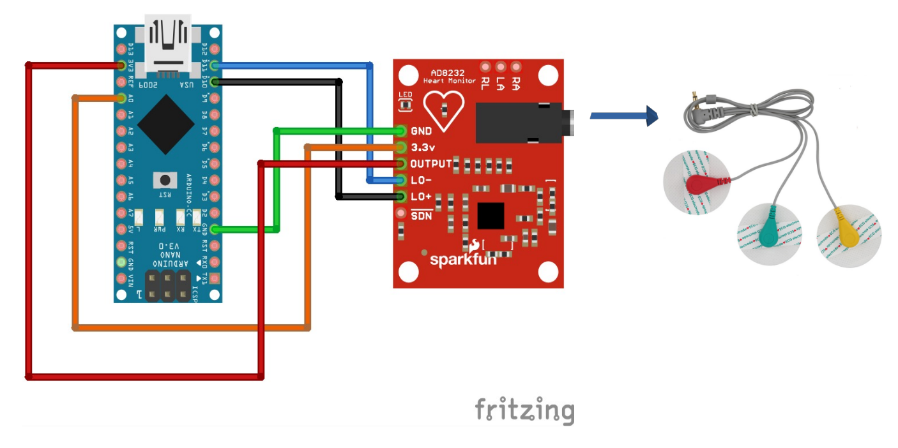
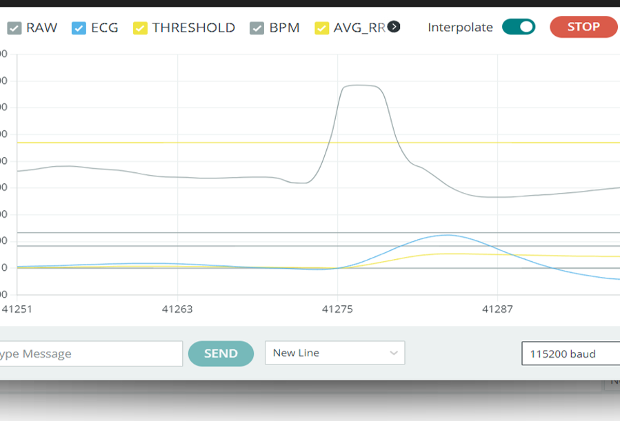
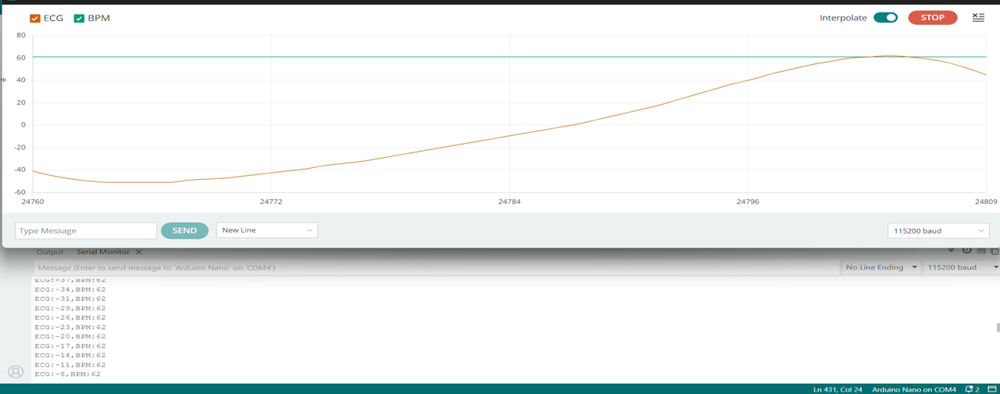

# Real-Time ECG Monitoring System

\<p align="center">
&#x20; \<strong>A Low-Cost Embedded System for Real-Time Electrocardiogram Acquisition and Heart Rate Estimation\</strong>
\</p>

\<p align="center">
&#x20; \
&#x20; \
&#x20; \
&#x20; \
&#x20; \
\</p>

---

## Overview

The **Real-Time ECG Monitoring System** is a low-cost embedded biomedical instrumentation project developed to acquire, process, and visualize electrocardiogram (ECG) signals in real time.

The system integrates an **AD8232 ECG sensor module** with an **Arduino Nano (ATmega328P)** to capture cardiac electrical activity through surface electrodes.

Digital signal processing techniques are implemented to improve signal quality, suppress unwanted noise, and support adaptive QRS complex detection. The system estimates heart rate in Beats Per Minute (BPM) by measuring the time interval between consecutive detected R-peaks.

This project demonstrates the practical application of embedded systems, biomedical instrumentation, and digital signal processing in physiological signal monitoring.

## Key Features

- Real-time ECG signal acquisition.
- Target sampling frequency of 250 Hz.
- 10-bit analog-to-digital conversion.
- Moving average filtering.
- Digital high-pass filtering.
- Digital low-pass filtering.
- Adaptive threshold-based R-peak detection.
- Slope-based peak identification.
- Refractory period for false peak suppression.
- RR interval measurement.
- Rolling-average BPM estimation.
- Electrode lead-off detection.
- Basic signal quality monitoring.
- Real-time serial data visualization.

## System Architecture

The system follows a sequential signal acquisition and processing architecture.

```text
             ECG Electrodes
                    |
                    v
               AD8232 Module
                    |
                    v
               Arduino Nano
                    |
                    v
           Raw ECG Acquisition
                    |
                    v
          Moving Average Filter
                    |
                    v
             High-Pass Filter
                    |
                    v
              Low-Pass Filter
                    |
                    v
          Adaptive QRS Detection
                    |
                    v
            RR Interval Analysis
                    |
                    v
             BPM Calculation
                    |
                    v
              Serial Output
```

## Hardware Requirements

| Component         | Description                          |
| ----------------- | ------------------------------------ |
| Arduino Nano      | ATmega328P microcontroller           |
| AD8232 ECG Module | Analog ECG signal acquisition        |
| ECG Electrodes    | Surface cardiac signal sensing       |
| Jumper Wires      | Hardware interconnections            |
| USB Cable         | Programming and serial communication |

## Hardware Circuit Diagram

The following Fritzing diagram illustrates the hardware interconnection between the Arduino Nano, AD8232 ECG sensor module, and three-electrode ECG cable.

\<p align="center">
&#x20; \
\</p>

### Pin Configuration

| AD8232 / Component | Arduino Nano |
| ------------------ | ------------ |
| OUTPUT             | A0           |
| LO+                | D10          |
| LO-                | D11          |
| 3.3V               | 3.3V         |
| GND                | GND          |

The three ECG electrodes are connected through the AD8232 electrode cable.

**Note:** Follow the AD8232 module manufacturer's specifications for electrode placement, power supply, and safe operation.

## Signal Processing Methodology

The acquired ECG signal passes through multiple processing stages before heartbeat detection.

### 1. ECG Signal Acquisition

The AD8232 module acquires the electrical activity of the heart and provides an analog output to the Arduino Nano.

The Arduino samples the analog signal through pin A0.

### 2. Moving Average Filter

A moving average filter is implemented to reduce high-frequency fluctuations in the acquired signal.

The mathematical expression is:

[
y[n]=\frac{1}{N}\sum\_{k=0}^{N-1}x[n-k]
]

Where:

- (x[n]) represents the input signal.
- (y[n]) represents the filtered output.
- (N) represents the number of samples.

The implementation uses a window size of 8 samples.

### 3. High-Pass Filter

A digital high-pass filter suppresses slow baseline variations associated with breathing and electrode movement.

The implementation uses a recursive filtering approach with a coefficient of 0.995.

### 4. Low-Pass Filter

A low-pass filter reduces high-frequency noise and smooths the processed ECG signal.

An exponential filtering approach is implemented with a coefficient of 0.45.

### 5. Adaptive QRS Detection

The system identifies potential R-peaks using an adaptive threshold and slope-based peak detection algorithm.

The detection process includes:

- Adaptive peak estimation.
- Dynamic threshold calculation.
- Rising and falling slope analysis.
- Refractory period enforcement.
- Minimum and maximum RR interval constraints.

A refractory period of 300 ms is used to prevent multiple detections within a short interval.

### 6. RR Interval Measurement

The RR interval represents the time between two consecutive detected R-peaks.

It is calculated using:

[
RR=t\_{R_n}-t\_{R\_{n-1}}
]

The implementation accepts RR intervals between 400 ms and 1800 ms for BPM estimation.

### 7. Heart Rate Calculation

The heart rate is calculated using:

[
BPM=\frac{60000}{RR}
]

Where RR is expressed in milliseconds.

A rolling buffer of five RR intervals is maintained to smooth the estimated heart rate.

## Experimental Configuration

| Parameter                    |        Value |
| ---------------------------- | -----------: |
| Microcontroller              | Arduino Nano |
| Processor                    |   ATmega328P |
| ECG Sensor                   |       AD8232 |
| Target Sampling Rate         |       250 Hz |
| Sampling Interval            |         4 ms |
| ADC Resolution               |       10-bit |
| Serial Baud Rate             |       115200 |
| Moving Average Window        |    8 samples |
| High-Pass Filter Coefficient |        0.995 |
| Low-Pass Filter Coefficient  |         0.45 |
| Refractory Period            |       300 ms |
| Minimum RR Interval          |       400 ms |
| Maximum RR Interval          |      1800 ms |
| RR Averaging Buffer          |  5 intervals |

## Experimental Results

The developed prototype demonstrated real-time ECG signal acquisition, digital filtering, heartbeat detection, and BPM estimation.

### 1. ECG Signal Visualization

The following screenshot demonstrates the raw ECG signal, processed ECG waveform, threshold, BPM indicator, and average RR interval visualization.

\<p align="center">
&#x20; \
\</p>

### 2. Real-Time Monitoring Output

The Arduino Serial Plotter and Serial Monitor demonstrate real-time signal visualization and heart-rate estimation.

An observed BPM reading of approximately **62 BPM** is visible in this experimental capture.

\<p align="center">
&#x20; \
\</p>

The experimental presentation separately reported an observed heart rate of approximately **65 BPM**.

These values represent separate experimental observations, not clinically validated accuracy measurements.

## Software Requirements

- Arduino IDE
- Arduino Nano board support
- USB serial communication
- Arduino Serial Monitor / Serial Plotter

## Getting Started

### 1. Clone the Repository

```bash
git clone https://github.com/abdullahalminhaz/Real-Time-ECG-Monitoring-System.git
```

### 2. Open the Project

Navigate to the `src` directory and open `ECG_Monitor.ino` using Arduino IDE.

### 3. Hardware Setup

Connect the AD8232 ECG module to the Arduino Nano according to the pin configuration described above.

### 4. Upload the Firmware

- Connect Arduino Nano to your computer.
- Select Arduino Nano from the Board menu.
- Select the appropriate processor and COM port.
- Upload the firmware.

### 5. Monitor ECG Signals

Open the Serial Monitor or Serial Plotter and configure the baud rate to:

```text
115200
```

Observe the processed ECG signal and calculated BPM output.

## Repository Structure

```text
Real-Time-ECG-Monitoring-System/
│
├── README.md
│
├── src/
│   └── ECG_Monitor.ino
│
├── docs/
│   └── BiomedicalEngineeringPresentation.pptx
│
├── Hardware/
│   └── circuit_connections.png
│
├── results/
│   ├── ecg_waveform.png
│   └── experimental_results.png
│
└── videos/
```

## Applications

- Biomedical instrumentation education.
- Embedded ECG signal acquisition.
- Biomedical signal processing.
- Real-time heart rate estimation.
- Low-cost physiological monitoring prototypes.
- Engineering laboratory demonstrations.

## Limitations and Future Improvements

Although the prototype demonstrates real-time ECG acquisition and basic heart rate estimation, several improvements can be explored:

- More robust QRS detection algorithms.
- Improved motion artifact suppression.
- Quantitative performance evaluation against a reference ECG device.
- ECG data storage and logging.
- Wireless ECG data transmission.
- Graphical user interface development.
- Validated heart rate variability analysis.
- IoT-based remote physiological monitoring.

## Project Presentation

The accompanying Biomedical Engineering project presentation is available here:

[View Biomedical Engineering Project Presentation](docs/BiomedicalEngineeringPresentation.pptx)

## Contributors

**Md. Rajesh Chowdhury**

**Abdullah Al Minhaz**

Department of Electrical and Electronic Engineering
Jamalpur Science & Technology University (JSTU)
Bangladesh.

## Acknowledgement

This project was developed as part of a Biomedical Engineering Laboratory assessment at Jamalpur Science & Technology University (JSTU), Bangladesh.

We would like to express our sincere gratitude to our project supervisor, **Md. Amimul Ihsan**, for his academic guidance, technical insights, continuous encouragement, and valuable suggestions throughout the development of this project.

His mentorship and research-oriented approach provided valuable direction in understanding biomedical instrumentation and practical engineering implementation.

### Project Supervisor

**Md. Amimul Ihsan**

*PhD Researcher, University of Toronto, Canada*
Lecturer (On Study Leave), Department of Electrical and Electronic Engineering
Jamalpur Science & Technology University (JSTU), Bangladesh.

**Academic Profiles:**

- [Google Scholar](https://scholar.google.com/citations?user=cMSNlgMAAAAJ\&hl=en)
- [LinkedIn](https://www.linkedin.com/in/amimul-ihsan-zami010763/)

## Disclaimer

This project is intended exclusively for educational and research purposes. It is an experimental prototype and is not a certified medical device. The measurements should not be used for clinical diagnosis, treatment decisions, or emergency medical assessment.

---

\<p align="center">   \<strong>Real-Time ECG Monitoring System\</strong>\<br/>   Biomedical Engineering | Embedded Systems | Digital Signal Processing \</p>

\<p align="center">   Developed at Jamalpur Science & Technology University, Bangladesh. \</p>
